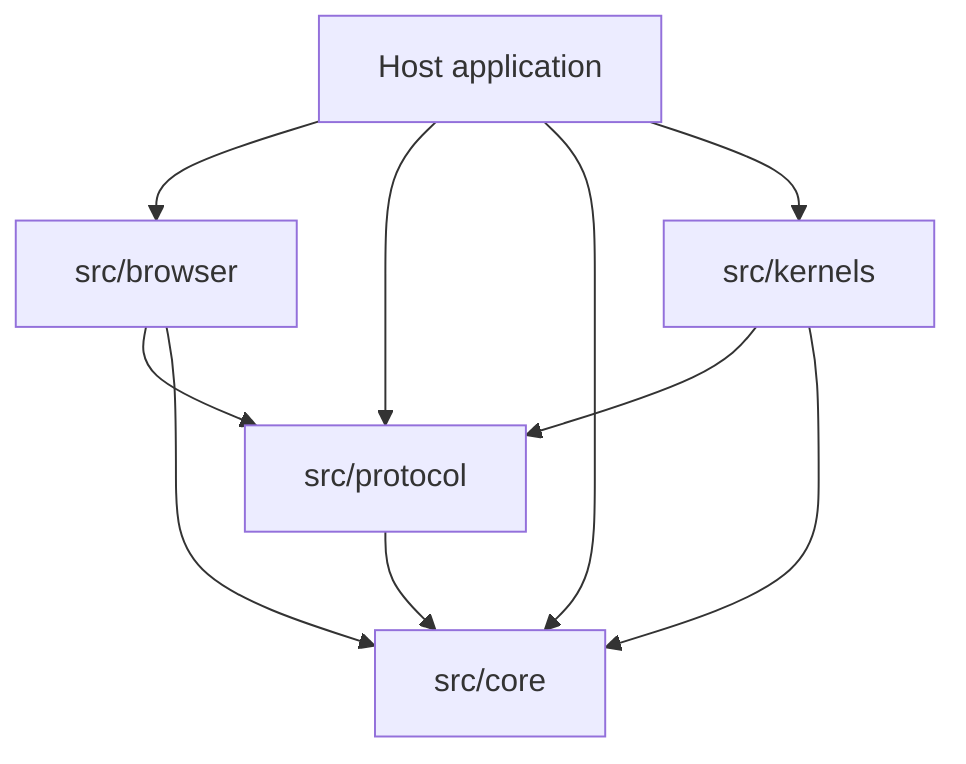

# Architecture

Closing a pane can leave its document, Undo history and retained view ready to reopen.
[Reference host](../examples/reference/main.ts)

## Use



Capture the pane before analysis. Await `settled` and check `isCurrent()` before display. Use the captured
revision for edits. Dispose on dismissal.

```ts
import type { TextBuffer } from "sttropez";
import { captureViewRequest, type TextEditor } from "sttropez/browser";

export function startAnalysis(
    editor: TextEditor,
    analyze: (buffer: TextBuffer, signal: AbortSignal) => Promise<string>
) {
    const capture = captureViewRequest(editor);
    if (!capture) return;
    const settled = (async () => {
        try {
            const value = await analyze(capture.document.buffer, capture.signal);
            if (!capture.isCurrent()) return undefined;
            return Object.freeze({
                documentId: capture.document.id, revision: capture.document.revision, value
            });
        } catch (error) {
            if (!capture.isCurrent()) return undefined;
            capture.cancel();
            throw error;
        }
    })();
    return Object.freeze({ settled, isCurrent: capture.isCurrent, dispose: capture.cancel });
}
```

## Contract

<a id="layers-and-enforcement"></a>

### What each layer can import

| Layer | Owns | Can use |
| --- | --- | --- |
| Core | Text, positions, documents, transactions and history | Core |
| Protocol | JSON-RPC/LSP, sync and regex-worker messages | Core, injected transport and scheduler |
| Kernels | Standalone algorithms and protocol clients | Core and protocol exports |
| Browser | DOM, input, rendering, controls and transports | Library modules and browser APIs |
| Host | Application UI, services and storage | Public entries and host dependencies |

Core and protocol compile against ES2022 without DOM, Node or ambient package types. Only `src/` contributes
to the runtime. [Public entries](api.md)

### Mutable state and lifetime

The resource owns revisions, permissions and history. Each document view keeps its selections and folds when
detached. The mounted editor owns native input, layout and the caret. A provider owns its
connection and synchronized documents. The host owns state shared across mounts.
[Input and recovery](editor.md) · [Transactions](workspace.md#transactions-and-history)

### Identity and asynchronous work

Capture a resource and server version for Save, a document revision for an edit, and a tab ID and generation
for a tab command. Moving a tab preserves its generation. A pane request also checks its view and request
identity. [View captures](host-integration.md#captured-view-requests)

### Snapshots and notification delivery

`getSnapshot()` retains its immutable value until the store changes. Subscribe to the field you display. The
workspace builds its inventory on demand. Schedule writes after notification delivery.
`workspace.onDocumentChange` reports individual edits. [Observables](workspace.md#observables)

### DOM and framework ownership

Give the editor an empty container. Keep host controls outside it. In React, mount with a stable ref, run
commands in handlers and use effects for listeners.
[React example](getting-started.md#mount-an-editor-in-react)

<a id="performance-invariants-and-cost-boundaries"></a>

### What costs time and memory?

Typing and scrolling bound the input context and rendered fragments. An edit near the start can invalidate
syntax through EOF. Large edit batches, full-text exports, resource listings, search and diff can visit the
full input. Retained text, caches and history cost memory. Measure startup, handler time and visible
completion separately. Check text, syntax, selection and gutter together.
[Interaction clocks](README.md#measuring-an-interaction) · [Testing](testing.md)

<a id="dependency-and-acceleration-policy"></a>

### Dependencies and alternatives to TypeScript

The runtime has zero third-party dependencies. A proposed WASM kernel must match TypeScript correctness,
cancellation and revision handling. Measure startup, encoding, copying and result conversion in the
comparison.

## Host responsibilities

Own endpoints, credentials, persistence and service execution. Dispose pane subscriptions with their mount
and release retained targets when a request finishes or is cancelled.
[Host integration](host-integration.md)

## Not covered

[Browser and device support](README.md#support-matrix)
