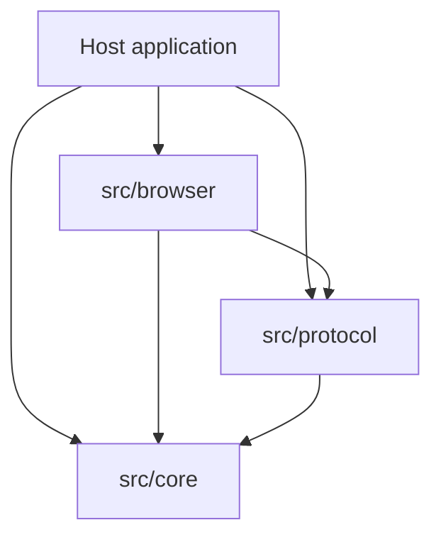

# Architecture

StTropez separates immutable text/workspace state, headless protocol coordination and browser
presentation. The host supplies application policy, services and surrounding UI. Each mutable
lifetime has one owner; delayed work carries captured identities and revisions instead of
consulting whichever tab or editor is active when it completes.

## Use

Place a feature in the layer that owns its effects. Dependencies point toward the headless
model; framework and application code consume public entry points.



A host analysis operation captures its view before awaiting work. It returns a cleanup handle
immediately, validates before publishing a result, and retains the capture while a displayed
result depends on it. The caller handles rejection, checks currentness before use and disposes
on dismissal, supersession or host teardown.

```ts
import type { DocumentView, TabId, TextBuffer, Workspace } from "sttropez";
import { captureViewRequest } from "sttropez/browser";

export function startAnalysis(
    workspace: Workspace,
    tabId: TabId,
    view: DocumentView,
    analyze: (buffer: TextBuffer, signal: AbortSignal) => Promise<string>
) {
    const capture = captureViewRequest(workspace, workspace.captureTab(tabId), view);
    if (!capture) return;
    const settled = (async () => {
        try {
            const value = await analyze(capture.document.buffer, capture.signal);
            if (!capture.isCurrent()) return undefined;
            return Object.freeze({
                documentId: capture.document.id, revision: capture.document.revision, value
            });
        } catch (error) {
            capture.cancel();
            throw error;
        }
    })();
    return Object.freeze({ settled, isCurrent: capture.isCurrent, dispose: capture.cancel });
}
```

The host bounds and schedules its analysis. A captured read does not authorize a later edit;
commands use the [workspace transaction contract](workspace.md#transactions-and-history).
See [captured-view requests](host-integration.md#captured-view-requests) for invalidation and
lease semantics.

## Contract

### Layers and enforcement

| Layer | Owns | Dependencies and effects |
| --- | --- | --- |
| `src/core` | Buffers, changes, selections, history, resources, transactions and headless computation | Core modules only; no DOM, React, Node, networking or storage APIs |
| `src/protocol` | JSON-RPC/LSP coordination and the private regex worker contract/session, including message validation | Protocol and core; transport/scheduling through supplied interfaces, without platform networking/storage APIs |
| `src/browser` | Editor DOM, native input, geometry, presentation scheduling and browser adapters | Browser, protocol and core; browser effects stay in this layer |
| Host application | Storage, authentication, service endpoints, resource routing, framework state, forms and controls | Public package entries; application dependencies stay in the host |
| Development tools/fixtures | Builds, servers, controlled providers, test hooks and measurement | Development dependencies; excluded from the library runtime graph |

Strict TypeScript checks include separate core and protocol compilations with ES2022 libraries
and no ambient package types. Those compilations reject use of DOM or Node globals. Runtime
bundling rejects resolved inputs outside `src/`, so development packages and reference material
cannot enter the emitted library graph. Dependency direction and ownership also require source
review; these checks are not a general platform-effect proof.

The public entries expose integration contracts, while internal modules own implementation
mechanisms. Package subpaths and payload boundaries are defined in [packaging](packaging.md).
Development worker protocols are fixtures; their behavior does not establish language-server
compatibility. The public [language-server contract](language-server.md) defines that boundary.

### Mutable state and lifetime

| Owner | State and lifetime |
| --- | --- |
| Workspace/resource | Authoritative content, revisions, capabilities, saved baseline, history and resource retention |
| Document view | Independent selections and folding over a shared document, including while detached |
| Editor input adapter | Native input context, composition capture, ordered input and delayed editing/navigation |
| Caret presentation | Caret DOM, placement cache and scheduled placement; no text edits, selection writes or command scheduling |
| Viewport | Rendered rows, scroll projection, native geometry and layout observers |
| Protocol provider/session | Connection state, document synchronization and shared feature scopes |
| Feature request | Captured context, cancellation and result lifetime within its provider/view owner |
| Host controller | Application navigation, menus/forms, commands, recovery and services across view remounts |

During composition, the input owner retains the captured revision, complete selection set and
native LF mapping. Commit or recovery resolves that capture before projection refresh. Delayed
word/grapheme/navigation commands share that owner's identity, input-order and authority guards.
Their computation can use headless cursors without creating an independent mutable input owner.
Caret presentation reads this state; the editor disposes it before destroying its viewport.

Workspace publishes atomic content/history/view changes. Save, Run and proposal policy use
captured resource APIs; extracting presentation or a computation helper does not split that
transaction authority. Resource, tab, document and view lifetimes follow the
[workspace ownership contract](workspace.md#identities-and-snapshots).

Language features share provider synchronization and request-lifetime machinery. Decoding and
confirmed edit/command policy have separate responsibilities. A cleanup-triggered cancellation
must not replace a concrete response/validation failure with an expiry message. Preparation
that intentionally edits must complete before synchronization captures the resulting revision.
See [language features](language-features.md) for feature-specific validation and action policy.

### Identity and asynchronous work

Resource keys identify host content; titles and paths displayed in UI are labels. Document
revision, saved server version, tab generation and view identity have different meanings.
The [identity glossary](README.md#glossary) and [workspace](workspace.md) define their contracts.

Capture the target before awaiting. Validate resource/document identity and the revision needed
by the operation, plus tab generation and view state when presentation depends on them. A newer
request against the same unchanged document also needs a request-generation or capture check.
Cancellation reduces unnecessary work; captured validation prevents stale work from applying.

A tab move does not change content identity. Replacement, closure or disposal invalidates work
according to its owner. Focus and array positions never select a delayed target. Services can
outlive a view; their resource leases and settlement follow the workspace operation contract.
A cleanup handle must be reachable as soon as setup acquires ownership.

### Snapshots and notification delivery

Public snapshots are immutable. Stable observable handles expose reads/subscription separately
from versioned commands; unchanged snapshots retain identity. Hosts subscribe at the narrowest
resource/document/field scope they need. A coarse workspace snapshot materializes its inventory
on demand, so callers requesting that aggregate pay its traversal cost.

Observers read published state. Commands run outside notification delivery, including nested
controller notifications. Listener failures are reported without preventing other delivery.
The detailed batching, callback and write-guard rules belong to
[workspace observables](workspace.md#observables). A host reactive library can consume the read
contract without sharing the workspace's synchronous write/completion semantics.

### DOM and framework ownership

The host owns an empty editor container and surrounding controls; StTropez owns descendants
that it mounts. Annotations, forms and other host surfaces use sibling containers and explicit
lifecycle/geometry APIs. Two renderers must not reconcile the same descendants.

Persistent host controllers own shared application state. Pure function components read stable
observable handles and invoke commands from events. Effects register and remove listeners;
loading, navigation, editor state and command orchestration belong to the controller, not an
effect, layout effect, memo callback or render-time side effect. Stable refs or explicit host
mount methods attach and detach views with symmetric cleanup. A view detach does not dispose
its retained document or application controller. See [embedding](getting-started.md) and
[host integration](host-integration.md) for recipes.

Host form snapshots can describe typed resources without pretending they are source strings.
A source-backed form uses one lossless conversion and explicit invalid-text states for that
same resource. Distinct settings, source and result resources retain separate identities and
save authority. Design-system controls, credentials, routing and service execution belong to
the host.

### Performance invariants and cost boundaries

These constraints guide implementation and regression ownership. They are not a universal
constant-time or latency guarantee.

| Work | Invariant | Cost boundary |
| --- | --- | --- |
| Native input and rendering | Bound the editing context and presented rows/fragments; separate measurements from DOM writes | Native processing, layout and indivisible platform calls have separate costs; the whole-value native control follows its own contract |
| Text edits and position mapping | Use range transactions, indexed buffers and shared history; do not export full source in routine input subscribers | Bulk changes, large selection sets and explicit string export have proportional work |
| Workspace/host updates | Publish scoped snapshots and retain unchanged identity | Requested aggregate inventories and tab-list changes can traverse their collections |
| Highlighting and diagnostics | Address captured revisions; prioritize visible fragments and bound scheduled work | Lexical invalidation and synchronization can cover a large source range; stale results cannot become edit authority |
| Search, comparison and proposals | Keep computation cancelable and apply only validated results | Global search, full comparison and source transfer can retain document-sized work; scheduling bounds do not remove that cost |
| Allocation and retention | Bound caches/history, share immutable content and release owned listeners/timers/leases | Garbage collection and retained native/browser memory require separate observation |
| Startup | Keep compiled assets coherent and distinguish optional feature activation | Download, parse, worker startup and first usable view are distinct from warm editing |

An input-handler duration alone cannot establish interaction readiness. Visible text,
selection, syntax decoration and comparison state form part of the user's result; gutter
movement or a single frame callback is insufficient when those outputs are pending. The
[glossary](README.md#glossary) owns clock definitions, and
[qualification](testing.md) describes test ownership.

### Dependency and acceleration policy

Runtime code has zero third-party dependencies. Reuse existing buffers, maps, controllers,
platform APIs and host extension points before adding a competing implementation. Generated
character facts carry their license notices; application parsers/frameworks stay outside the
runtime. Rendering and Unicode ownership are described in [Unicode](unicode.md).

Ordinary editing and lifecycle are implemented in TypeScript. A proposed compute accelerator requires
an isolated measured kernel, bounded inputs/outputs, equivalent TypeScript behavior and captured
cancellation/version checks. Measurements include encoding, copying, allocation, startup and
return conversion. Worker scheduling and accelerated computation solve different costs.
A compiler, managed runtime or WASM runtime is not added without that evidence.

## Host responsibilities

Own application services, policy and framework state. Retain exact targets before asynchronous
work; validate before use and clean up each acquired owner on failure or teardown. Preserve
immutable snapshots and resource identities across remounts. Keep input, presentation and
background jobs responsive through bounded work and scoped subscriptions.

Contributors place new behavior with its state owner, preserve strict layer boundaries and
update the owning API page when a public contract changes. Qualification should exercise the
changed guarantee at its owner and reserve broad browser/package checks for coherent milestones.

## Not covered

See the [support matrix](README.md#support-matrix) for feature and native-device boundaries.
