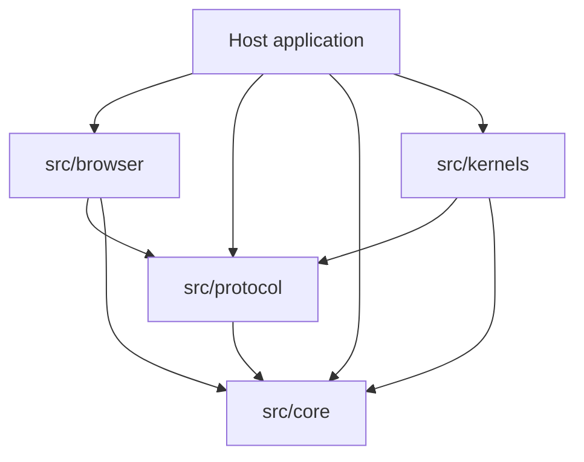

# Architecture

The workspace owns text, revisions and Undo. An editor mounts a view of that text. Its host can
close the editor, keep the document and reopen it with the same history.
[Reference host](../examples/reference/main.ts) · [Embedding walkthrough](getting-started.md#use)

## Use

The browser layer supplies the DOM and browser transports. Core and protocol also run headless.



Tie a pane-local analysis to the editor that requested it. The host may reuse the document view
in a later mount while the old request is pending.

```ts
import type { TextBuffer } from "sttropez";
import { captureViewRequest, type TextEditor } from "sttropez/browser";

export function startAnalysis(
    editor: TextEditor,
    analyze: (buffer: TextBuffer, signal: AbortSignal) => Promise<string>
) {
    const capture = captureViewRequest(editor.workspace, editor.tab, editor.view, {
        available: () => !editor.signal.aborted
    });
    if (!capture) return;
    editor.signal.addEventListener("abort", capture.cancel, { once: true, signal: capture.signal });
    const settled = (async () => {
        try {
            const value = await analyze(capture.document.buffer, capture.signal);
            if (!capture.isCurrent()) return undefined;
            return Object.freeze({
                documentId: capture.document.id, revision: capture.document.revision, value
            });
        } catch (error) {
            if (!capture.isCurrent()) return undefined;
            capture.cancel();
            throw error;
        }
    })();
    return Object.freeze({ settled, isCurrent: capture.isCurrent, dispose: capture.cancel });
}
```

Await `settled` and check `isCurrent()` before showing or applying the result. Use the captured
revision for edits. Dismissal calls `dispose()`. [View captures](host-integration.md#captured-view-requests) · [Transactions](workspace.md#transactions-and-history)

## Contract

<a id="layers-and-enforcement"></a>

### What each layer can import

| Layer | Responsibility | Dependencies |
| --- | --- | --- |
| `src/core` | Buffer, positions, selections, documents, transactions and history | Core modules |
| `src/protocol` | JSON-RPC/LSP, synchronization and regex-worker messages | Core, injected transport and scheduler |
| `src/kernels` | Public entry for standalone algorithms and protocol clients | Re-exports from core and protocol |
| `src/browser` | Input, rendering, editor controls and browser adapters | Library modules and browser APIs |
| Host | Tabs and surrounding UI, storage, authentication, routing and services | Public entries and host dependencies |

Core and protocol type-check against ES2022 without DOM, Node or ambient package types. The runtime
build accepts only `src/` inputs. Tooling and fixtures may use development dependencies.
[Public entries](api.md) · [Package contents](packaging.md)

### Mutable state and lifetime

| Owner | State |
| --- | --- |
| Workspace and resource | Working and saved contents, revision, permissions, shared history, tabs and leases |
| Document view | Directed selections and folds, including while detached |
| Editor input adapter | Native text context, composition, pending navigation and ordered edits |
| Viewport and caret | Visible fragments, scroll projection, layout observers and caret placement |
| Language provider and feature scope | Connection, synchronized documents, pending requests and cancellation |
| Host controller | Navigation history, commands, forms, recovery and services that span mounts |

Composition captures its revision, selections and native LF offsets. The input adapter commits or
recovers the text before refreshing. The queue drains in bounded turns and recovers unconsumed input
on cancellation. An edit commits text, view state and history together. [Editor input](editor.md) · [Workspace transactions](workspace.md#transactions-and-history)

### Identity and asynchronous work

Capture the identity the operation depends on before the first `await`. A save checks the resource
and expected server version. An edit checks the document revision. A tab command checks the tab ID
and generation, which survives a move and expires on replacement or close. A pane-local result
also depends on the view and the request that produced it. Two requests can share a revision.
[Identity and capture terms](README.md#glossary)

### Snapshots and notification delivery

`getSnapshot()` returns the same immutable value until it changes. Subscribe to the document or
field you display. The workspace builds its full inventory on demand. Changed stores publish
before listeners run. Schedule writes after delivery. For an edit-by-edit feed, use
`workspace.onDocumentChange`. [Workspace observables](workspace.md#observables)

### DOM and framework ownership

Mount an editor in an empty container. Keep host forms and interactive annotations outside its
subtree. React components read stable controller handles and run commands in event handlers.
Use stable refs to mount editors and effects to register listeners. Keep the controller and
document alive across remounts. [React mounting](getting-started.md#mount-an-editor-in-react) · [Source-backed forms](host-integration.md#tokenization-annotations-and-forms)

<a id="performance-invariants-and-cost-boundaries"></a>

### What costs time and memory?

| Operation | Where work scales |
| --- | --- |
| Typing and scrolling | Native input context and rendered fragments are bounded. DOM writes, layout and presentation have separate clocks. Check that text, selection, syntax and gutter all appear. |
| Edits and history | Range edits share indexed buffers. Many selections, dense batches and explicit full-text exports add work. |
| Workspace notifications | Read only the displayed snapshot. Listing all resources or tabs visits the collection. |
| Syntax and diagnostics | Visible fragments get priority. An edit near the beginning can invalidate a long suffix. |
| Search and comparison | Full results can require a document scan or diff across several turns. A host can provide a dedicated regex worker. |
| Memory and startup | Retained text, history and caches consume memory. Account separately for downloading assets, parsing modules, worker startup and first render. |

[Interaction clocks](README.md#measuring-an-interaction) · [Measurement procedures](testing.md)

<a id="dependency-and-acceleration-policy"></a>

### Dependencies and alternatives to TypeScript

The runtime has zero third-party dependencies. Before introducing WASM or another runtime,
compare one kernel against its TypeScript implementation, including startup, copying, encoding
and conversion of the result. Both implementations must meet the same correctness, cancellation
and revision requirements.

## Host responsibilities

Own credentials, endpoints, persistence and service execution. Retain the targets that delayed
work needs and release them on failure, cancellation or teardown. Scope view subscriptions to
their mounts. [Host integration](host-integration.md)

## Not covered

[Browser and device support](README.md#support-matrix)
