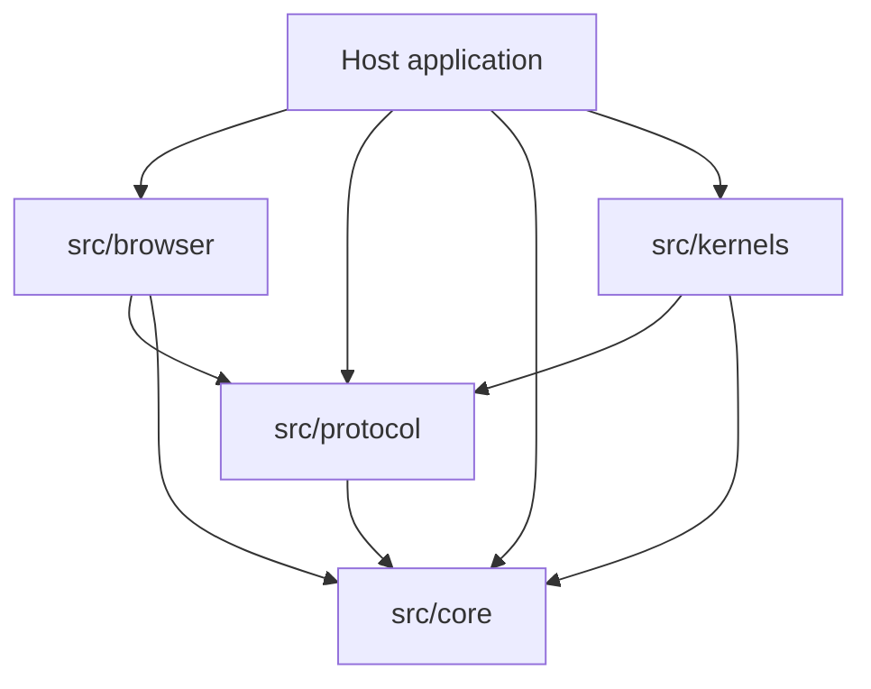

# Architecture

The workspace owns the text and undo history. Browser panes and language clients read from it.
You can close a pane and reopen the same unsaved document with its undo history intact.
Your application decides when to release the file, where to save it and which services to call.

## Use

An application uses `sttropez` for workspace state, `sttropez/browser` for editor views
and `sttropez/protocol` for language clients. Import `sttropez/kernels` for standalone
algorithms or direct access to JSON-RPC and LSP messages.



A host can keep a document view when it closes a pane. Tie analysis to the mount that
requested it so a reply from the old pane expires even if the same view reopens.

```ts
import type { TextBuffer } from "sttropez";
import { captureViewRequest, type TextEditor } from "sttropez/browser";

export function startAnalysis(
    editor: TextEditor,
    analyze: (buffer: TextBuffer, signal: AbortSignal) => Promise<string>
) {
    const capture = captureViewRequest(editor.workspace, editor.tab, editor.view, {
        available: () => !editor.signal.aborted
    });
    if (!capture) return;
    editor.signal.addEventListener("abort", capture.cancel, { once: true, signal: capture.signal });
    const settled = (async () => {
        try {
            const value = await analyze(capture.document.buffer, capture.signal);
            if (!capture.isCurrent()) return undefined;
            return Object.freeze({
                documentId: capture.document.id, revision: capture.document.revision, value
            });
        } catch (error) {
            if (!capture.isCurrent()) return undefined;
            capture.cancel();
            throw error;
        }
    })();
    return Object.freeze({ settled, isCurrent: capture.isCurrent, dispose: capture.cancel });
}
```

Await `settled` and check `isCurrent()` before displaying or acting on the result. Closing the
pane cancels its analysis. Call `dispose()` when the user dismisses or replaces it. To apply
an edit, submit the revision the analysis read. [Transactions](workspace.md#transactions-and-history) · [When a view capture expires](host-integration.md#captured-view-requests)

## Contract

<a id="layers-and-enforcement"></a>

### What each layer can import

| Layer | What goes here | What it can use |
| --- | --- | --- |
| `src/core` | Buffers, edits, selections, history, resources and transactions. Runs without a browser. | Other core modules. No DOM, React, Node, network or storage APIs. |
| `src/protocol` | JSON-RPC/LSP sessions and the regex worker's private protocol. Validates messages. | Core and protocol modules. The caller supplies transport and scheduling through interfaces. |
| `src/kernels` | Public entry for text algorithms, JSON-RPC, LSP sessions and diagnostic decoding | Re-exports core and protocol modules. |
| `src/browser` | Editor DOM, native input, caret geometry, drawing and browser adapters | Browser APIs and all three library layers |
| Host application | Storage, authentication, service endpoints, file routing, framework state, forms and controls | Public package entries and the application's dependencies |
| Development tools and fixtures | Builds, servers, test providers, hooks and measurement | Development dependencies. These tools aren't part of the shipped runtime. |

Core and protocol compile with ES2022 and no ambient package types. Using `document` or a Node
global in either layer fails the type check. The runtime build rejects inputs outside `src/`.

For the published entry points, see [Packaging](packaging.md). The development host includes a
test peer for the [supported language-server messages](language-server.md).

### Mutable state and lifetime

| Owner | State and lifetime |
| --- | --- |
| Workspace/resource | Current contents and revision, permitted operations, last saved contents, undo history and the tabs or leases keeping the resource open |
| Document view | Independent selections and folding over a shared document, including while detached |
| Editor input adapter | Native input context, composition capture, ordered input and delayed editing/navigation |
| Caret presentation | Caret DOM, placement cache and scheduled placement; no text edits, selection writes or command scheduling |
| Viewport | Rendered rows, scroll projection, native geometry and layout observers |
| Protocol provider/session | Connection state, document synchronization and shared feature scopes |
| Feature request | Captured context, cancellation and result lifetime within its provider/view owner |
| Host controller | Application navigation, menus/forms, commands, recovery and services across view remounts |

During composition the input adapter captures the revision, all selections and the native LF
mapping. It commits or recovers the text before refreshing the input. Word, grapheme and navigation
commands use the same ordering and edit guards.

The ordered-input queue drains actions in bounded turns. A commit releases its recovery text before
notifying the view. Cancellation returns only unconsumed input. Editing, folding, comparison, find
and bracket matching share scheduling helpers. Each controller checks its own captures, disposes
iterators and publishes its result. Dispose the caret before the viewport.

The workspace commits text, history and view changes atomically. Save tickets capture the resource and revision at invocation. See [workspace ownership](workspace.md#identities-and-snapshots).

Language clients share synchronization and cancellation. If preparation edits the document,
synchronize the resulting revision. Preserve provider and validation errors when cleanup also
cancels a request. See [language features](language-features.md).

### Identity and asynchronous work

Choose the identity that can change while a request is in flight. A save that overwrites a server
copy needs the resource and the server version it expects. A suggested edit needs the document revision
whose offsets it uses. A command for a particular tab needs its ID and generation. Moving the tab
preserves both. Replacing its contents changes the generation, and closing it removes the target.

Capture the target and acquire any lease before the first `await`. When the reply arrives,
check the capture, any selection or view state the result used, and whether a newer request
superseded it. Two requests can read the same revision. Give the caller a way to cancel while
it waits. [Identity and capture terms](README.md#glossary)

### Snapshots and notification delivery

Reading an observable twice returns the same immutable object until something changes. Subscribe
to the document, resource or field you display. Read the workspace snapshot when you need the
whole inventory. The workspace builds it on demand.

Workspace transactions and queued LSP updates publish all changed stores before listeners run. A
failed listener does not prevent other listeners from receiving the update. Read state during
notification and issue commands after delivery, including for nested controller notifications. See
[workspace observables](workspace.md#observables).

### DOM and framework ownership

Give the editor an empty container. It owns the descendants it mounts. Put host forms and
annotations in sibling containers and position them with the geometry API.

In React, keep shared state in a controller. Pure components read stable observables and invoke
commands from event handlers. Stable refs mount and detach editor views. Effects register and remove
listeners. Keep the document and controller alive across a view remount. See
[embedding](getting-started.md) and [host integration](host-integration.md).

A source-backed form needs a lossless conversion and a way to display invalid source. Separate
settings, source and result resources keep their own identities and save permissions. The host owns
credentials, routing and service execution.

<a id="performance-invariants-and-cost-boundaries"></a>

### What costs time and memory?

| Operation | How StTropez limits the work | Where the cost grows |
| --- | --- | --- |
| Typing and scrolling | Cap the native editing context and the rows or fragments rendered. Measure layout separately from DOM writes. | Native input, layout and browser calls that cannot yield |
| Editing and mapping positions | Apply edits by range and share indexed buffers and history. Read only the changed range in a routine input subscriber. | Bulk edits, many selections and exporting a whole file as a string |
| Updating the workspace | Publish a new snapshot for each field that changed. | Reading the full inventory or changing the list of tabs can visit the whole collection. |
| Highlighting and diagnostics | Work on a captured revision and prioritize visible fragments. Bound the work per turn. | A change near the start of a file can invalidate coloring or require synchronization across a large range. Check the revision before using a result to edit. |
| Searching and comparing | Let the caller cancel a search, diff or proposed change. Check its result before applying it. | A full search, comparison or transfer can require work proportional to the document, spread across several turns. |
| Memory | Limit caches and history, share immutable text and release listeners, timers and leases. | Measure garbage collection and memory the browser retains separately. |
| Startup | Load a matching set of assets and measure optional features when they start. | Downloading and parsing modules, starting a worker and showing the first view have different costs from editing an open file. |

For an edit or scroll, check when the correct text, selection, colors and comparison appear. A
gutter update can precede the text. See the [clock definitions](README.md#measuring-an-interaction) and
[test procedures](testing.md).

<a id="dependency-and-acceleration-policy"></a>

### Dependencies and alternatives to TypeScript

Runtime code has zero third-party dependencies. Reuse the existing buffers, controllers and platform
APIs. Keep frameworks and application parsers in the host. Generated character data retains its
[Unicode](unicode.md) notices.

Before adding a compiler, WASM or a managed runtime, time one operation against its TypeScript
implementation. Include startup, encoding, copying, allocation and conversion back to TypeScript.
Check that both versions produce the same results and respect the same limits, cancellation and
revision checks.

## Host responsibilities

The host owns services, routing and framework state. Capture targets before starting work, release
them on failure or teardown, and retain document identity across remounts. Use scoped subscriptions
for view updates. See [testing](testing.md#test-ownership) when changing a contract.

## Not covered

For questions about a specific browser or input device, such as dead keys or touch
selection, check the [support matrix](README.md#support-matrix).
