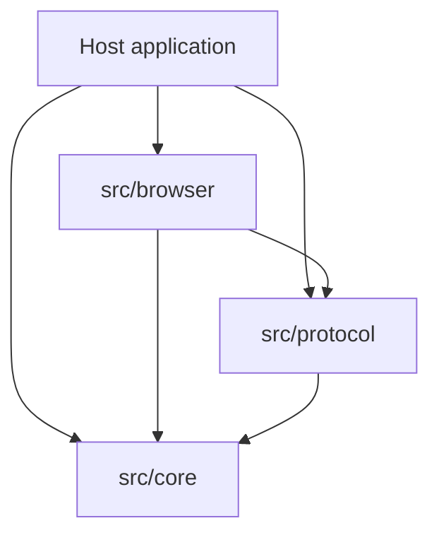

# Architecture

The browser editor and protocol clients share a headless text and workspace model. The host supplies
storage, services and surrounding UI.

## Use

Put platform access in an outer layer. Hosts import the public entries.



Capture the target before starting asynchronous analysis. Return a cleanup handle immediately. While
the result is visible, retain the capture and check it before use. Dispose it on dismissal,
replacement or teardown, and handle rejected requests.

```ts
import type { DocumentView, TabId, TextBuffer, Workspace } from "sttropez";
import { captureViewRequest } from "sttropez/browser";

export function startAnalysis(
    workspace: Workspace,
    tabId: TabId,
    view: DocumentView,
    analyze: (buffer: TextBuffer, signal: AbortSignal) => Promise<string>
) {
    const capture = captureViewRequest(workspace, workspace.captureTab(tabId), view);
    if (!capture) return;
    const settled = (async () => {
        try {
            const value = await analyze(capture.document.buffer, capture.signal);
            if (!capture.isCurrent()) return undefined;
            return Object.freeze({
                documentId: capture.document.id, revision: capture.document.revision, value
            });
        } catch (error) {
            capture.cancel();
            throw error;
        }
    })();
    return Object.freeze({ settled, isCurrent: capture.isCurrent, dispose: capture.cancel });
}
```

The host bounds and schedules its analysis. A captured read does not authorize a later edit;
commands use the [workspace transaction contract](workspace.md#transactions-and-history).
See [captured-view requests](host-integration.md#captured-view-requests) for invalidation and
lease semantics.

## Contract

### Layers and enforcement

| Layer | Owns | Dependencies and effects |
| --- | --- | --- |
| `src/core` | Buffers, changes, selections, history, resources, transactions and headless computation | Core modules only; no DOM, React, Node, networking or storage APIs |
| `src/protocol` | JSON-RPC/LSP coordination and the private regex worker contract/session, including message validation | Protocol and core; transport/scheduling through supplied interfaces, without platform networking/storage APIs |
| `src/browser` | Editor DOM, native input, geometry, presentation scheduling and browser adapters | Browser, protocol and core; browser effects stay in this layer |
| Host application | Storage, authentication, service endpoints, resource routing, framework state, forms and controls | Public package entries; application dependencies stay in the host |
| Development tools/fixtures | Builds, servers, controlled providers, test hooks and measurement | Development dependencies; excluded from the library runtime graph |

Core and protocol compile with ES2022 and no ambient package types. DOM or Node globals fail these
checks. The runtime build rejects inputs outside `src/`. Review imports and platform effects when
changing a layer.

[Packaging](packaging.md) lists the public entries and assets. The development host’s synthetic peer
exercises the [supported language-server protocol](language-server.md).

### Mutable state and lifetime

| Owner | State and lifetime |
| --- | --- |
| Workspace/resource | Authoritative content, revisions, capabilities, saved baseline, history and resource retention |
| Document view | Independent selections and folding over a shared document, including while detached |
| Editor input adapter | Native input context, composition capture, ordered input and delayed editing/navigation |
| Caret presentation | Caret DOM, placement cache and scheduled placement; no text edits, selection writes or command scheduling |
| Viewport | Rendered rows, scroll projection, native geometry and layout observers |
| Protocol provider/session | Connection state, document synchronization and shared feature scopes |
| Feature request | Captured context, cancellation and result lifetime within its provider/view owner |
| Host controller | Application navigation, menus/forms, commands, recovery and services across view remounts |

During composition the input adapter captures the revision, all selections and the native LF
mapping. It commits or recovers the text before refreshing the input. Word, grapheme and navigation
commands use the same ordering and edit guards.

The ordered-input queue drains actions in bounded turns. A commit releases its recovery text before
notifying the view. Cancellation returns only unconsumed input. Editing, folding, comparison, find
and bracket matching share scheduling helpers. Each controller checks its own captures, disposes
iterators and publishes its result. Dispose the caret before the viewport.

The workspace commits text, history and view changes atomically. Save and Run capture the resource
at invocation. See [workspace ownership](workspace.md#identities-and-snapshots).

Language clients share synchronization and cancellation. If preparation edits the document,
synchronize the resulting revision. Preserve provider and validation errors when cleanup also
cancels a request. See [language features](language-features.md).

### Identity and asynchronous work

Use the resource key to identify content and the revision to identify the text you read. The saved
server version, tab generation and view each serve a separate purpose. See the
[glossary](README.md#glossary).

Before awaiting a service, capture the target and take any resource lease it needs. Before applying
the reply, check the target, revision and any view state the result depends on. Check request
generation too: two requests can target the same revision. A tab move preserves identity.
Replacement or closure can invalidate the target. Expose cleanup immediately so the host can cancel
an abandoned operation.

### Snapshots and notification delivery

Public observables return immutable snapshots with stable identity until a change. Subscribe to a
document, resource or field when possible. Reading the coarse workspace snapshot builds its
inventory on demand.

Workspace transactions and queued LSP updates publish all changed stores before listeners run. A
failed listener does not prevent other listeners from receiving the update. Read state during
notification and issue commands after delivery, including for nested controller notifications. See
[workspace observables](workspace.md#observables).

### DOM and framework ownership

Give the editor an empty container. It owns the descendants it mounts. Put host forms and
annotations in sibling containers and position them with the geometry API.

In React, keep shared state in a controller. Pure components read stable observables and invoke
commands from event handlers. Stable refs mount and detach editor views. Effects register and remove
listeners. Keep the document and controller alive across a view remount. See
[embedding](getting-started.md) and [host integration](host-integration.md).

A source-backed form needs a lossless conversion and a way to display invalid source. Separate
settings, source and result resources keep their own identities and save permissions. The host owns
credentials, routing and service execution.

### Performance invariants and cost boundaries

The table distinguishes work bounded per turn from work that grows with the input.

| Work | Invariant | Cost boundary |
| --- | --- | --- |
| Native input and rendering | Bound the editing context and presented rows/fragments; separate measurements from DOM writes | Native processing, layout and indivisible platform calls have separate costs |
| Text edits and position mapping | Use range transactions, indexed buffers and shared history; do not export full source in routine input subscribers | Bulk changes, large selection sets and explicit string export have proportional work |
| Workspace/host updates | Publish scoped snapshots and retain unchanged identity | Requested aggregate inventories and tab-list changes can traverse their collections |
| Highlighting and diagnostics | Address captured revisions; prioritize visible fragments and bound scheduled work | Lexical invalidation and synchronization can cover a large source range; stale results cannot become edit authority |
| Search, comparison and proposals | Keep computation cancelable and apply only validated results | Global search, full comparison and source transfer can retain document-sized work; scheduling bounds do not remove that cost |
| Allocation and retention | Bound caches/history, share immutable content and release owned listeners/timers/leases | Garbage collection and retained native/browser memory require separate observation |
| Startup | Keep compiled assets coherent and distinguish optional feature activation | Download, parse, worker startup and first usable view are distinct from warm editing |

For an edit or scroll, check when the correct text, selection, colors and comparison appear. A
gutter update can precede the text. See the [clock definitions](README.md#glossary) and
[test procedures](testing.md).

### Dependency and acceleration policy

Runtime code has zero third-party dependencies. Reuse the existing buffers, controllers and platform
APIs. Keep frameworks and application parsers in the host. Generated character data retains its
[Unicode](unicode.md) notices.

To propose a compute accelerator, measure one kernel against the TypeScript implementation,
including startup, encoding, copies, allocation and conversion back. Preserve results, bounds,
cancellation and revision checks. Require this evidence before adding a compiler or a WASM or
managed runtime.

## Host responsibilities

The host owns services, routing and framework state. Capture targets before starting work, release
them on failure or teardown, and retain document identity across remounts. Use scoped subscriptions
for view updates. See [testing](testing.md#test-ownership) when changing a contract.

## Not covered

See the [support matrix](README.md#support-matrix) for feature and native-device boundaries.
